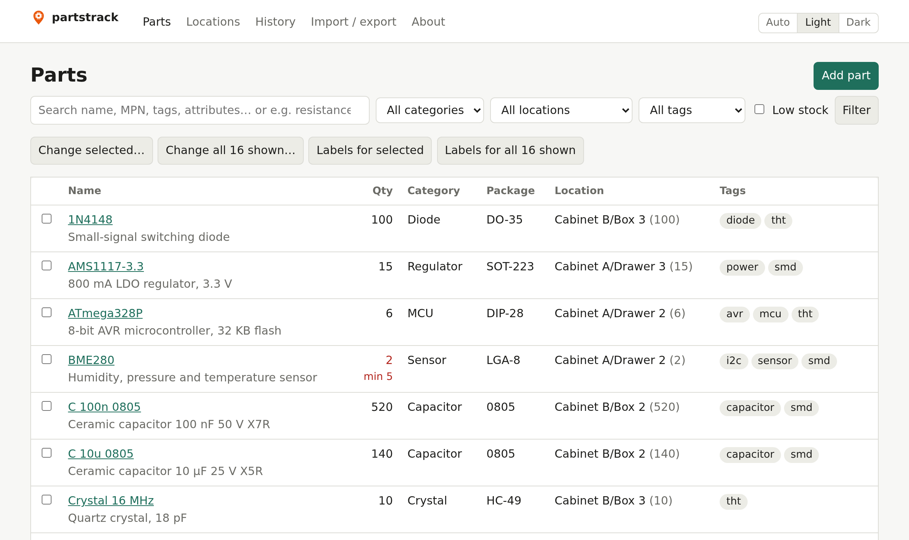
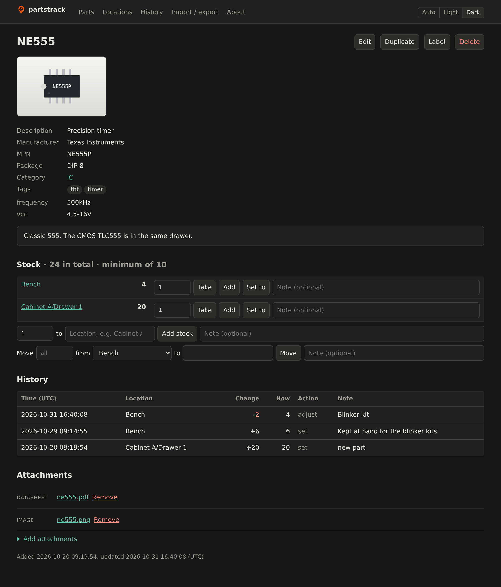
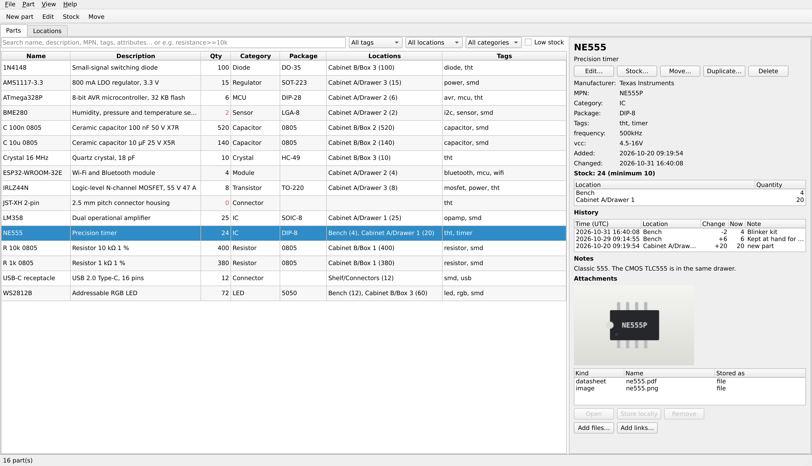
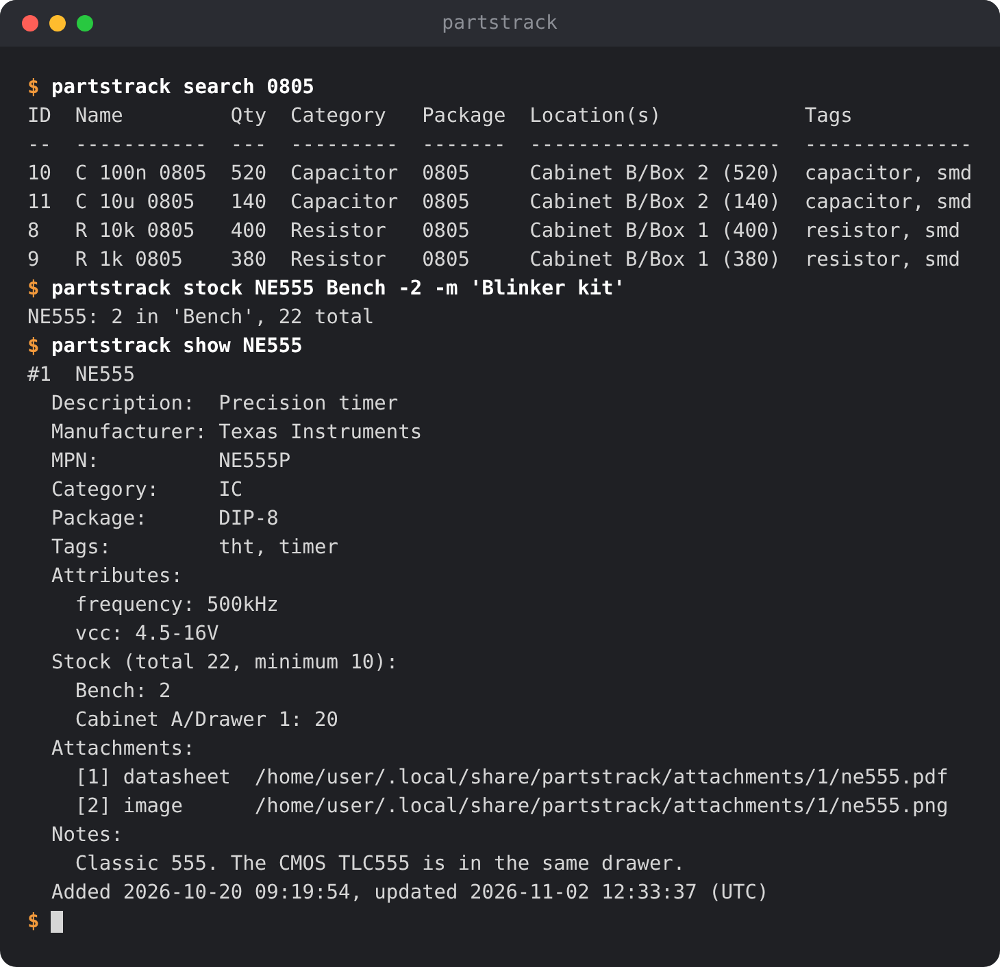

# partstrack


A small inventory for electronic parts, backed by SQLite. It records what you
have, how many, where they are stored (in nested locations), and attributes
such as datasheets, pictures, tags and free-form key/value attributes. Parts can
be imported from and exported to CSV.

The command-line app uses only the Python standard library (Python 3.10+). The
optional web interface needs Flask and waitress, and the optional desktop app
needs PySide6 (Qt).

## Screenshots

The [web interface](#web-interface), for use from any browser on your network:



A part's page in dark mode:



The [desktop app](#desktop-app) on Linux:



The [command-line app](#examples):



## Contents

- [Install / run](#install--run)
- [Examples](#examples)
- [Searching by attribute](#searching-by-attribute)
- [Low stock and history](#low-stock-and-history)
- [Locations](#locations)
- [CSV import and export](#csv-import-and-export)
- [Web interface](#web-interface)
- [JSON API](#json-api)
- [Labels with QR codes](#labels-with-qr-codes)
- [Desktop app](#desktop-app)
  - [Read-only copies of a server's inventory](#read-only-copies-of-a-servers-inventory)
- [Backups](#backups)
- [Layout](#layout)
- [Tests](#tests)
- [License](#license)

## Install / run

```sh
python3 -m partstrack --help          # run from the source folder
pip install -e .                      # or install the `partstrack` command
```

The database lives at `~/.local/share/partstrack/parts.db` by default. Override
it with `--db FILE` or the `PARTSTRACK_DB` environment variable. Attached files
are copied into an `attachments/` folder next to the database, so back up that
whole folder.

## Examples

```sh
partstrack add NE555 -d "Precision timer" -m TI --mpn NE555P -c IC -p DIP-8 \
    -q 20 -l "Drawer A3" -t timer -t tht -a vcc=4.5-16V \
    --datasheet ~/Downloads/ne555.pdf --image https://example.com/ne555.jpg

partstrack stock NE555 "Drawer A3" -3     # take 3   (+N adds, N sets)
partstrack move NE555 "Drawer A3" Bench 5 # move 5 (omit the number to move all)
partstrack ls                             # list everything
partstrack search 0805 10k                # all words must match
partstrack ls -t smd -l "Drawer A3"       # filter by tag / location / category (-c)
partstrack show NE555
partstrack edit NE555 -t opamp --untag tht -a package-marking=NE555
partstrack attach NE555 photo.jpg         # kind guessed from extension, or -k
partstrack attach NE555 https://example.com/ne555.pdf  # downloaded and stored
partstrack detach 3                       # attachment id from `show`
partstrack download                       # store all linked files locally
partstrack download NE555 --dry-run       # ... or one part's; just list them
partstrack tags
partstrack copy NE555 NE556                # same fields, tags and attributes; no stock or attachments
partstrack rm NE555
```

Links that end in a file name (`…/ne555.pdf`, `…/pinout.png?v=2`) are
downloaded and stored like uploaded files, and the original link is
remembered. This happens in `add`, `attach`, `import` and the web interface.
Links to web pages (`…/products/ne555`, `…/index.html`) stay links. So do links
whose download fails; you get a warning and can retry later with
`partstrack download`. Use `--link` to keep a link to a file as a link. For
safety, files are never downloaded from the server itself or from link-local
addresses.

## Searching by attribute

Search words of the form `key=value`, `key:text`, `key<value`, `key<=value`,
`key>value` and `key>=value` filter on an attribute instead of searching all
text. They work everywhere you can search (CLI, web interface, desktop app) and
combine with other words and filters:

```sh
partstrack search 'resistance>=10k' smd   # quote <, > and spaces in the shell
partstrack search 'resistance=4k7'        # also matches 4.7k, 4700, 4.7 kΩ
partstrack search 'capacitance<=100n' 'voltage>=25V'
partstrack search vcc:16                  # the attribute value contains "16"
partstrack search vcc:                    # parts that have a vcc attribute
partstrack search '"forward voltage"<1V'  # keys with spaces go in double quotes
```

Keys and text compare case-insensitively. `=` matches the whole value, as text
or as a number. `<`, `<=`, `>` and `>=` compare numbers, which may have a
decimal comma, an SI prefix (p, n, u or µ, m, k or K, M, G, T) and a unit
(ignored): `10k`, `100nF`, `3,3V`, `1MHz`. Resistor codes such as `4k7`, `2R2`
and `R47` work too. Values that are not a single number, like `4.5-16V`, never
match a comparison; use `:` for those.

## Low stock and history

```sh
partstrack edit NE555 --min 10            # less than 10 in total counts as low stock
partstrack ls --low                       # what to reorder (combines with -t, -l, -c)
partstrack edit NE555 --no-min            # remove the minimum
partstrack stock NE555 Bench -5 -m "amp board"  # -m: note for the history (also for move)
partstrack history NE555                  # the newest 50 stock changes of NE555
partstrack history -l "Cabinet A" -n 0    # all changes in Cabinet A and inside it
```

Every stock change is recorded with the time (UTC), the location, the change,
the new quantity and an optional note; the first stock of a new part is noted
as "new part", and CSV imports note the file name. Deleting
a part deletes its history too. Stock that existed before the history was added
appears as one `initial` entry per location.

Parts are referred to by name (case-insensitive) or by id. Use `#12` to force
an id lookup when a part's name is itself a number. For that reason, part
names cannot start with `#`.

## Locations

Locations can be nested and are written as paths:

```sh
partstrack loc add "Lab/Cabinet A/Drawer 3" -d "SMD ICs"  # parents are created too
partstrack stock NE555 "Drawer 3" +10   # the last part is enough if it's unambiguous
partstrack stock NE555 "/Drawer 3" +10  # leading '/': exactly this top-level path
partstrack locs                         # show the tree
partstrack ls -l "Cabinet A"            # parts in Cabinet A or anywhere inside it
partstrack loc edit "Cabinet A" --rename "Cabinet 1" --parent Storeroom
partstrack loc edit "Cabinet 1" --top-level
partstrack loc rm "Drawer 3"            # only when empty
```

Locations are created automatically when you first put stock into them.

## CSV import and export

```sh
partstrack export -o parts.csv                      # or to stdout without -o
partstrack export -o parts.csv --delimiter ";" --bom  # for German-locale Excel
partstrack import parts.csv --dry-run               # check only
partstrack import parts.csv
partstrack import order.csv --add-stock -l Incoming # e.g. a distributor order
```

The CSV has one row per part and location. Columns are `name`, `description`,
`manufacturer`, `mpn`, `category`, `package`, `location`, `quantity`, `min_quantity`, `tags`,
`datasheets`, `images`, `other_attachments`, `notes`, plus one `attr:<name>`
column per attribute. Lists within a cell are separated by `;`. Exported
locations are full paths starting with `/`, so importing them never lands in a
different location that merely ends with the same name.

When importing:
- Only `name` is required. Unknown columns are ignored with a warning, and a
  few common header names (`Qty`, `Part Number`, ...) are recognised.
- Files may be UTF-8 or Windows-1252 (what Excel writes in Western European
  locales).
- Parts are matched by name. New parts are created and existing ones updated.
  Empty cells never clear existing values.
- Quantities replace the stock at that location, or are added to it with
  `--add-stock`. Rows without a location use `-l/--location`.
- Attachment paths may be relative to the CSV file. Attachments that are
  already present are not added again, so export → edit → import is safe.
- The import is all-or-nothing. If any row has an error, nothing is saved.

## Web interface

A browser interface for use on a local network, served by the machine that
holds the database:

```sh
python3 -m venv .venv
.venv/bin/pip install -e '.[web]'
.venv/bin/partstrack-web                    # http://<server>:8080/, all interfaces
.venv/bin/partstrack-web --port 9000 --db /srv/partstrack/parts.db
.venv/bin/partstrack-web --host 127.0.0.1   # this machine only
.venv/bin/partstrack-web --url http://parts.lan:8080/  # the address in QR codes on labels
```

It covers the same features as the CLI: searching and filtering, adding and
editing parts, taking, adding and moving stock, uploading pictures and
datasheets (pictures are shown on the part's page), the location tree, and CSV
import/export. Parts can have a minimum quantity; the parts list can show
only the parts below it, and a History page lists all stock changes. The parts
list is split into pages of 25, 50 (the default), 100 or all parts; the browser
remembers your choice. To change several parts at once, tick them in the parts
list (or use *Change all matching* for everything the current search and filters
find, on every page) and choose *Change selected…*: add or remove tags, set the category, move all their stock (or only
what is in one location) to another location, or delete them. While you type tags, existing tags are suggested. The header has a switch for light mode, dark mode, or following
the device's setting, and an About page shows the version. The CLI and the web interface can be used on the same database
at the same time.

**There is no login.** Anyone who can reach the port can view and change the
inventory, so only run it on a network you trust. For the same reason, CSV
imports through the browser only accept links as attachments, never file paths
on the server. Changes are only accepted from partstrack's own pages, so other
websites you visit can't make your browser change the inventory.

To run it as a service with systemd, use a unit like this (adjust user and
paths):

```ini
[Unit]
Description=partstrack web interface
After=network.target

[Service]
User=partstrack
ExecStart=/opt/partstrack/.venv/bin/partstrack-web --db /srv/partstrack/parts.db --port 8080
Restart=on-failure

[Install]
WantedBy=multi-user.target
```

## JSON API

The web interface also answers in JSON under `/api`, for scripts and other
programs, such as an app on your phone. Reading needs nothing:

```sh
curl http://parts.lan:8080/api                        # the endpoints and the version
curl 'http://parts.lan:8080/api/parts?q=smd&low=1'    # filters: q, tag, location, category, low
curl 'http://parts.lan:8080/api/parts?q=resistance%3E%3D10k'  # resistance>=10k, URL-encoded
curl http://parts.lan:8080/api/parts/12
curl http://parts.lan:8080/api/locations
curl http://parts.lan:8080/api/locations/3
curl http://parts.lan:8080/api/tags
curl http://parts.lan:8080/api/categories
curl 'http://parts.lan:8080/api/history?part=12&limit=0'  # stock changes; limit 0 for all
```

Parts include their stock, tags, attributes, minimum quantity and whether they
are low on stock. Attachments are links to the web interface. Errors come back
as `{"error": "..."}` with a 4xx status.

Changes need an **API token**. Create one per device or program on the
server; it is shown only once (the database keeps only a hash of it), so copy
it right away:

```sh
partstrack token add "Pixel 8"   # prints the token, pt_…
partstrack token list            # names, and when each was last used
partstrack token rm "Pixel 8"    # revoke it, e.g. for a lost phone
```

Send it in the `Authorization` header. Bodies are JSON objects; locations are
full paths as the API returns them (`Cabinet/Drawer 3`), and missing ones are
created where stock is put:

```sh
TOKEN=pt_...
AUTH="Authorization: Bearer $TOKEN"
curl -H "$AUTH" --json '{"name": "NE555", "package": "DIP-8", "tags": ["timer"],
  "stock": [{"location": "Cabinet/Drawer 3", "quantity": 20}]}' http://parts.lan:8080/api/parts
curl -H "$AUTH" -X PATCH --json '{"min_quantity": 10}' http://parts.lan:8080/api/parts/12
curl -H "$AUTH" --json '{"location": "Cabinet/Drawer 3", "delta": -2, "note": "amp board"}' \
  http://parts.lan:8080/api/parts/12/stock          # or "quantity" for the new amount
curl -H "$AUTH" --json '{"from": "Cabinet/Drawer 3", "to": "Bench", "quantity": 5}' \
  http://parts.lan:8080/api/parts/12/move           # without "from", all stock moves
curl -H "$AUTH" -X DELETE http://parts.lan:8080/api/parts/12
curl -H "$AUTH" --json '{"path": "Shelf/Box 1"}' http://parts.lan:8080/api/locations
curl -H "$AUTH" -X PATCH --json '{"name": "Box A", "parent": null}' http://parts.lan:8080/api/locations/3
curl -H "$AUTH" -X DELETE http://parts.lan:8080/api/locations/3
curl -H "$AUTH" -F file=@top.jpg http://parts.lan:8080/api/parts/12/attachments   # upload a file
curl -H "$AUTH" --json '{"url": "https://example.com/ne555.pdf"}' \
  http://parts.lan:8080/api/parts/12/attachments    # a link; files are downloaded
curl -H "$AUTH" -X DELETE http://parts.lan:8080/api/parts/12/attachments/7
```

Uploads take one file per request, with an optional `kind` (`datasheet`,
`image` or `other`; by default guessed from the name). A link that points to a
file is downloaded and stored, as in the web interface, unless the request says
`"download": false`; if the download fails, the link is kept and the answer
says why in `download_error` (try again with `POST
/api/parts/<id>/attachments/<id>/download`). `/api` lists all fields each change accepts. Unknown fields are refused, so a
typo doesn't go unnoticed, and each request is saved completely or not at all.
Changes answer with the changed part or location. Snapshots (`/api/snapshot`)
leave out the tokens.

The token only guards changes through the API: the web interface itself still
has no login, and anyone who can reach it can read the inventory and change it
there. To use partstrack from outside your home network, reach it through a
VPN (e.g. WireGuard) rather than exposing the port to the internet. Tokens are
sent in plain text over HTTP, so they are only as private as the network.

## Labels with QR codes

Labels for storage locations and parts carry a QR code. Scanning it with a
phone on your network opens the web interface: a location's label shows the
parts stored there (and in its sublocations), a part's label shows the part.
A location label shows the location's name, its parent path and description;
a part label shows the name, the package (or the MPN if there is no package)
and the description.

- **Web interface:** tick locations on the Locations page or parts in the
  parts list and choose *Print labels for selected* (or *for all*), or use the
  *Label* button on a part's page. Choose a layout and print the page with the
  browser at 100 % scale, without headers and footers.
- **Desktop app:** *File → Print labels…* (Ctrl+P) or *Labels…* on the
  Locations tab. Check the locations and parts, then preview, print or save a
  PDF.

Layouts: plain A4 paper with cut lines, A4 sticker sheets (3 × 8, 3 × 7,
4 × 10 and 2 × 8 labels, or a custom grid copied from the sheet's packaging),
and label printers (62 × 29 mm, 89 × 36 mm or a custom size, one label per
page). *Start at label* skips labels that are already used on the first
sheet. "Include sublocations" prints a location together with everything
inside it.

The QR codes contain the web interface's address as other devices reach it.
Give it with `partstrack-web --url` (or `PARTSTRACK_URL`); otherwise the
address you opened the page with is used, and the page warns you if that is
`localhost`. The desktop app asks for the address once and remembers it.
Labels need the `segno` package, which the `web` and `desktop` extras install.

## Desktop app

A native window for Windows and Linux, working directly on the database:

```sh
python3 -m venv .venv
.venv/bin/pip install -e '.[desktop]'      # Windows: .venv\Scripts\pip install -e .[desktop]
.venv/bin/partstrack-desktop                 # or: partstrack-desktop --db D:\parts\parts.db
```

The Parts tab has a searchable, filterable and sortable table, with the
selected part's details, stock, recent stock changes, pictures and attachments
next to it. "Low stock" shows only the parts below their minimum quantity.
Double-click a part to edit it, a stock entry to change it, or an attachment
to open it. **Part → Duplicate…** (Ctrl+D) starts a new part with the selected
part's fields, tags and attributes; the web interface has a *Duplicate* button
on each part's page that does the same. The Locations tab shows the location tree. CSV import shows what a
file contains before anything is saved. **File → Open database…** switches to
another database file (or creates one), and the app remembers it. **View →
Theme** chooses light, dark or the system's setting.

The desktop app, the CLI and the web interface can all be used on the same
database at the same time. The desktop app doesn't notice changes made
elsewhere until you press F5 (View → Refresh).

### Read-only copies of a server's inventory

**File → Download copy from server…** downloads the inventory of a
`partstrack-web` server, with its attachments, into a folder on this computer
(by default `server-copy` next to the default database), for example to take
it along on a laptop. Enter the web interface's address, the same one the
label dialog uses.

A copy always opens read-only, in the CLI too: everything that would change it
is disabled, and the window title and status bar say where and when it was
copied. This
way no changes can be made that would be lost, because nothing goes back to
the server. A later download into the same folder replaces the copy. The
folder must be empty or hold an earlier copy, so no other database is ever
overwritten. **File → Open database…** goes back to your own database.

The server offers the copy at `/api/snapshot`, as a `.tar.gz` with the same
layout as the backups below.

**File → Open backup…** opens a backup made by the backup script below (or a
snapshot saved from `/api/snapshot`) the same way: read-only, to look up what
the inventory was like. It is unpacked into an `opened-backup` folder next to
the default database, which is replaced by the next backup you open. To restore
a backup, unpack it as described below.

## Backups

`contrib/systemd/` contains a backup script and a systemd timer that runs it
daily. Each run writes `partstrack-<timestamp>.tar.gz` with the database and
the `attachments/` folder, and keeps the newest 5 backups. The database is
copied with SQLite's backup API, so this is safe while the web server or the
desktop app is running.

The script can also be run by hand: `partstrack-backup DEST_DIR`. `KEEP` sets
the number of backups to keep (at least 1) and `PARTSTRACK_DB` the database to
back up. Only files named like the backups are ever deleted.

For your own database, use the user units in `contrib/systemd/user/`:

```sh
install -m 755 contrib/systemd/partstrack-backup ~/.local/bin/
cp contrib/systemd/user/partstrack-backup.{service,timer} ~/.config/systemd/user/
# edit the destination in ~/.config/systemd/user/partstrack-backup.service
systemctl --user daemon-reload
systemctl --user enable --now partstrack-backup.timer
sudo loginctl enable-linger "$USER"     # run even when you're not logged in

systemctl --user start partstrack-backup.service   # back up now
journalctl --user -u partstrack-backup              # see the output
```

To restore, close the desktop app and unpack a backup into the database folder:
`tar -xzf partstrack-<timestamp>.tar.gz -C ~/.local/share/partstrack`.

When the web server runs as a system service under its own user (here
`partstrack`), use the system units in `contrib/systemd/system/` instead. They
run the backup as that user. In the service file, set the destination and
`PARTSTRACK_DB` to the database the web server uses.

```sh
sudo install -m 755 contrib/systemd/partstrack-backup /usr/local/bin/
sudo install -d -o partstrack -g partstrack -m 750 /mnt/backup/partstrack
sudo cp contrib/systemd/system/partstrack-backup.{service,timer} /etc/systemd/system/
# edit the destination and PARTSTRACK_DB in /etc/systemd/system/partstrack-backup.service
sudo systemctl daemon-reload
sudo systemctl enable --now partstrack-backup.timer

sudo systemctl start partstrack-backup.service   # back up now
journalctl -u partstrack-backup                  # see the output
```

To look at a backup without restoring it, open it in the desktop app with
**File → Open backup…**. To restore, stop the web service and unpack as the `partstrack` user, so the
files keep the right owner:
`sudo -u partstrack tar -xzf partstrack-<timestamp>.tar.gz -C /var/lib/partstrack`.

## Layout

- `partstrack/store.py` holds the `Inventory` class with all database logic.
  It returns dataclasses (`Part`, `Location`, `Attachment`, ...) and raises
  `InventoryError` for user errors. It never prints, so a GUI can use it
  directly. Wrap several calls in `with inv.transaction():` to save them
  all-or-nothing. Transactions nest, and a failed inner block is undone on its
  own.
- `partstrack/csvio.py` contains CSV import/export on top of `Inventory`.
- `partstrack/labels.py` computes label layouts and contents for both the web
  interface and the desktop app.
- `partstrack/snapshot.py` makes, downloads and unpacks the read-only copies
  of a server's inventory.
- `partstrack/cli.py` is the command-line front end, a thin layer over `Inventory`.
- `partstrack/web/` holds the web front end: a Flask app in `app.py`, the
  JSON API in `api.py`, plus Jinja templates and a stylesheet.
- `partstrack/desktop/app.py` is the desktop front end (PySide6).
- Schema changes go into `MIGRATIONS` in `store.py`. They are applied
  automatically using SQLite's `user_version`.

## Tests

```sh
python3 -m unittest -v          # web and desktop tests are skipped without Flask / PySide6
.venv/bin/python -m unittest -v # everything, with the web and desktop extras installed
```

## License

Copyright (C) 2026 Kayla Theil

partstrack is free software: you can redistribute it and/or modify it under the
terms of the GNU General Public License as published by the Free Software
Foundation, either version 3 of the License, or (at your option) any later
version. It is distributed WITHOUT ANY WARRANTY. See [LICENSE](LICENSE) for the
full text.
